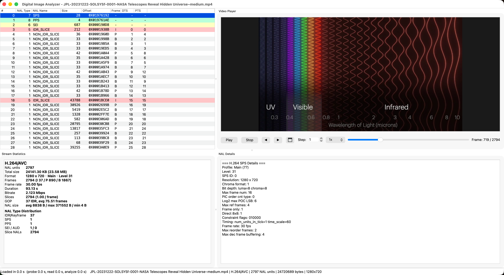

# Digital Image Analyzer

**Inspect, understand and play H.264/AVC and H.265/HEVC bitstreams.**

**English** | [简体中文](README_CN.md)

[](LICENSE)
[](#building)
[](https://github.com/blocksmith314/DigitalImageAnalyzer/releases)

Digital Image Analyzer is a desktop tool for video engineers, students and
anyone curious about what is inside a compressed video. It opens raw Annex B
streams and MP4/MOV/MKV/TS containers, decodes every NAL unit, parameter set,
slice header and SEI message, and pairs that structural view with
frame-accurate playback.

The NAL table and the player are linked in both directions: scrub the timeline
and the NAL units of the current frame are highlighted; click a NAL unit and
the player jumps to the frame that contains it.

## Screenshot



## Highlights

- **Decode order vs display order** — every access unit is listed with its DTS
  and PTS, making B-frame reordering easy to follow.
- **Complete parameter-set parsing** — SPS/PPS (plus VPS for HEVC) decoded field
  by field: profile, level, chroma format, bit depth, cropping, VUI timing,
  POC type, slice groups, 8x8 transform and more.
- **SEI messages** — user data (encoder name and options), recovery points,
  mastering display colour volume, content light level and alternative
  transfer characteristics.
- **Built for large files** — memory-mapped parsing, an MP4 sample-table fast
  path and lazy frame decoding keep multi-GB files responsive.
- **Frame-accurate playback** — play/pause, speed control, configurable frame
  stepping, fullscreen and audio with PTS-driven A/V sync.

## Supported input

| Type | Formats |
|------|---------|
| Raw bitstreams | `.h264`, `.264`, `.h265`, `.265`, `.hevc` (Annex B) |
| Containers | MP4, MOV, M4V, MKV, TS |
| Video codecs | H.264/AVC, H.265/HEVC |
| Audio playback | AAC, MP3, AC-3 and other FFmpeg decoders |

## Features

### Bitstream analysis

- NAL unit table with type, name, size, file offset, frame type, DTS and PTS
- Slice header details: first MB, slice type, POC, reference index
- Stream statistics: resolution, frame rate, frame count, I/P/B distribution,
  bitrate, GOP size and NAL size distribution
- Detailed view for SPS/PPS/VPS fields, SEI payloads and slice information
- Frame-type colour coding and linked highlighting between table and player

### Playback

- Play/pause, stop, previous/next frame and a configurable step of 1–1000
- Playback speed from 0.25x to 3x
- Fullscreen via double-click or the toolbar button (`Esc` to leave)
- Ring-buffered audio output with PTS-driven A/V sync

### Large files

- Memory-mapped I/O: NAL metadata is parsed without loading the whole file
- MP4 sample-table fast path and on-demand frame decoding
- Loading progress with cancel, plus per-stage timings in the status bar

## Requirements

- CMake 3.21+ and a C++17 compiler
- Qt 6.4+ with the **Widgets** and **Multimedia** modules
- FFmpeg 5+ (`libavformat`, `libavcodec`, `libavutil`, `libswscale`,
  `libswresample`)
- `pkg-config`

## Building

### macOS

```sh
brew install cmake ninja qt ffmpeg pkg-config
cmake -B build -G Ninja -DCMAKE_BUILD_TYPE=Release -DCMAKE_PREFIX_PATH="$(brew --prefix)"
cmake --build build
```

### Debian / Ubuntu

```sh
sudo apt install cmake ninja-build pkg-config \
    qt6-base-dev qt6-multimedia-dev \
    libavformat-dev libavcodec-dev libavutil-dev \
    libswscale-dev libswresample-dev
cmake -B build -G Ninja -DCMAKE_BUILD_TYPE=Release
cmake --build build
```

### Windows (MSYS2, MINGW64 shell)

```sh
pacman -S mingw-w64-x86_64-cmake mingw-w64-x86_64-ninja mingw-w64-x86_64-gcc \
          mingw-w64-x86_64-pkgconf mingw-w64-x86_64-qt6-base \
          mingw-w64-x86_64-qt6-multimedia mingw-w64-x86_64-ffmpeg
cmake -B build -G Ninja -DCMAKE_BUILD_TYPE=Release -DCMAKE_PREFIX_PATH=/mingw64
cmake --build build
```

### Helper tools

The build also produces small utilities under `build/test/`:

```sh
# generate a synthetic raw stream (width height fps frames keyint codec output)
./build/test/tools/gen 1280 720 30 120 30 libx264 /tmp/test.h264

# print H.264 slice headers (frame_num / POC) for the bundled sample
./build/test/tools/slice_header_dump

# verify NAL grouping and PTS ordering
./build/test/tools/frame_map test/data/output.h264
```

## Usage

| Action | Shortcut / control |
|--------|--------------------|
| Open a file | `Ctrl+O` (File → Open) |
| Play / pause | `Space` |
| Previous / next frame | `←` / `→` (uses the **Step** value) |
| Fullscreen | double-click the video or the fullscreen button; `Esc` to exit |
| Seek | drag the timeline slider |
| Playback speed | toolbar combo box |
| Inspect a NAL unit | click its row in the NAL table |
| Jump to a frame | scrub the timeline; matching NAL rows are highlighted |

The **Step** spin box sets how many frames the arrow keys and the
previous/next buttons jump (1–1000).

## Release artifacts

Prebuilt binaries are attached to the
[releases page](https://github.com/blocksmith314/DigitalImageAnalyzer/releases):

- macOS (Apple Silicon and Intel)
- Linux (AppImage)
- Windows (x64)

## Third-party components

This project bundles Qt and FFmpeg at runtime. See
[THIRD_PARTY_NOTICES.md](THIRD_PARTY_NOTICES.md) for the exact licenses and
source locations.

## License

Distributed under the **GNU General Public License v3.0 or later**
(GPL-3.0-or-later). See [LICENSE](LICENSE).

## Contributing

Issues and pull requests are welcome at
<https://github.com/blocksmith314/DigitalImageAnalyzer>. When reporting a
problem with a specific file, please include the codec, container and a short
description of what the analyzer shows (profile/level and frame count help a
lot).
